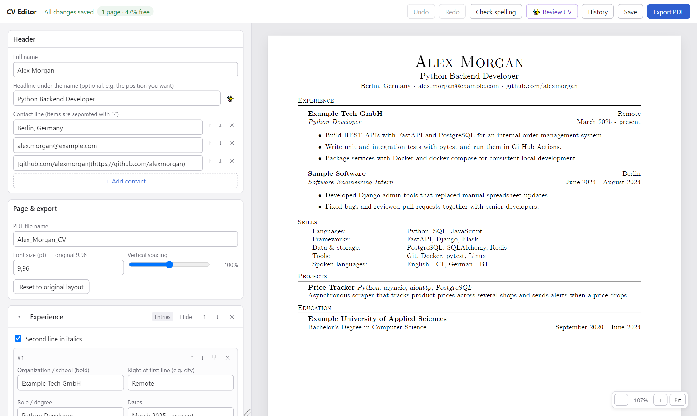

# CV Editor

A local editor for a one-page CV in the classic LaTeX résumé style. You edit your CV in a form and see a live preview. One click exports a clean PDF that applicant tracking systems (ATS) can read. Optional AI help writes bullet points and reviews the whole CV.



## Features

- **Live preview** that matches the exported PDF exactly: A4, Computer Modern fonts, LaTeX-style layout.
- **PDF export** with headless Chromium. The text layer is real and selectable, in the correct reading order, and links are clickable.
- **Structured editing:** sections, jobs, projects, skills and bullet points can be added, reordered, duplicated or hidden.
- **Fit indicator** that shows whether the CV still fits on one page and how much space is left. Font size and spacing are adjustable.
- **Light and dark mode** for the editor (☾ / ☀ in the top bar). The CV page always stays white. It follows your system setting until you pick one.
- **Undo/redo**, plus **version history**: every save keeps the previous version, and any of them can be restored.
- **Spell check:** the browser underlines misspellings as you type (English dictionary). **Check spelling** proofreads the whole CV: spelling, grammar and tech-name capitalisation (e.g. "Postgresql" → "PostgreSQL"). Each fix shows a word-by-word diff and can be applied individually, or all at once with **Apply all**.
- **AI helper (✨)**, optional:
  - Turns rough notes, in any language, into CV bullet points.
  - Suggests better wording for a bullet point and suggests headlines.
  - **Review CV** gives recruiter-style feedback: a score, strengths, and issues ranked by importance. Most fixes can be applied with one click. You can paste a job posting to tailor the review.

## Quick start

Requires Python 3.10+.

```bash
git clone <this repo>
cd CV_editor
pip install -r requirements.txt
playwright install chromium
python server.py
```

The editor opens at http://127.0.0.1:8765. On Windows you can also double-click `run.bat`.

On first run, the editor creates `data/cv.json` from `data/cv.example.json`. Replace the example content with your own.

## Using it

- **Save** (Ctrl+S) writes `data/cv.json`. The previous version goes to `backups/`, and the 50 most recent versions are kept. **History** restores one.
- **Export PDF** (Ctrl+E) saves, then writes `output/<PDF file name>.pdf`.
- **Formatting inside any text:** `**bold**`, `*italic*`, `[link text](https://…)`. Email addresses in the contact line become clickable automatically.
- **In bullet points:** Enter starts a new bullet, Backspace on an empty bullet deletes it, and Shift+Enter adds a line break.
- `data/cv.json` is plain JSON and is fine to edit by hand too.

## AI helper

No API key is needed if you use [Claude Code](https://claude.com/claude-code). The editor runs it in the background with `claude -p`, with no tools and no saved session, using your Claude subscription. Install it and sign in once by running `claude` in a terminal.

You can use an Anthropic API key instead. Paste it under **AI settings** in any ✨ dialog, or set the `ANTHROPIC_API_KEY` environment variable. API usage is billed separately. A pasted key is stored in `~/.cv_editor/anthropic_key`, outside the project folder.

| Task | Default model | Why |
|---|---|---|
| Writing bullets and headlines | Claude Haiku 5.5, low effort | Short rewrites; fast and light on usage |
| Spelling & grammar | Claude Haiku 5.5, medium effort | Catches typos and grammar without rewriting your style |
| CV review | Claude Sonnet 5.5, medium effort | Needs judgment across the whole CV |

You can choose a different model, Opus 5.5 included, in each dialog, and the editor remembers the choice. The prompts tell the model to use only facts you provided and never invent numbers or results. Still, check everything it writes.

## Privacy

- Everything runs locally. The server listens only on `127.0.0.1`, and it rejects requests from other websites.
- Your CV (`data/cv.json`), `backups/` and `output/` are git-ignored, so your personal details are never committed.
- CV text is sent to Claude only when you use an AI feature.

## Project structure

```
server.py            local web server: load/save, backups, PDF export, AI endpoints
ai.py                AI prompts and calls (Claude Code CLI or Anthropic API)
static/render.js     CV data -> HTML (shared by preview and PDF export)
static/cv.css        CV page layout (A4, LaTeX look)
static/cv.html       page rendered in the preview and exported to PDF
static/editor.*      editor UI
static/fonts/        Computer Modern Unicode web fonts
data/cv.example.json example CV used on first run
```

## Credits and license

- Fonts: [Computer Modern Unicode](https://cm-unicode.sourceforge.io/) (CMU Serif), licensed under the SIL Open Font License 1.1.
- Code: MIT License, see [LICENSE](LICENSE).
